<a id="readme-top"></a>

<div align="center">
  

  <h1>Siaga Kelas</h1>

  <p><strong>Jam kosong bukan lagi jam bebas.</strong></p>

  <p>
    Satu tombol mengirim kit belajar yang sudah disiapkan guru ke guru piket,<br>
    saat guru mapel berhalangan. MVP untuk hackathon <strong>STACK 2026</strong>.
  </p>

  <p>
    <a href="docs/DEMO.md"><strong>Skrip demo 3 menit</strong></a> ·
    <a href="#menjalankan">Menjalankan</a> ·
    <a href="docs/DECISIONS.md">Keputusan desain</a> ·
    <a href="#known-limitations">Known limitations</a>
  </p>

  <p>
    
    
    
    
    
  </p>
  <p>
    
    
    
    
  </p>

  <br>
  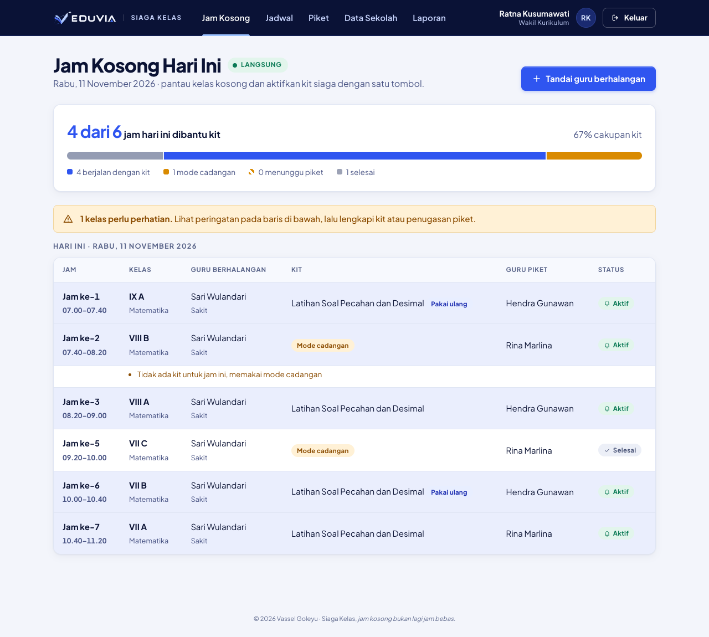
</div>

<details>
  <summary><strong>Daftar isi</strong></summary>

1. [Tentang proyek](#tentang-proyek)
2. [Fitur utama](#fitur-utama)
3. [Menjalankan](#menjalankan) · [Akun demo](#akun-demo)
4. [Alur utama](#alur-utama)
5. [Arsitektur](#arsitektur) · [Dibangun dengan](#dibangun-dengan)
6. [Tes dan kualitas](#tes-dan-kualitas)
7. [Keamanan](#keamanan)
8. [Ringan untuk perangkat sekolah](#ringan-untuk-perangkat-sekolah)
9. [Desain dan aksesibilitas](#desain-dan-aksesibilitas)
10. [Struktur singkat](#struktur-singkat)
11. [Known limitations](#known-limitations)
12. [Peta jalan](#peta-jalan)
13. [Penulis dan lisensi](#penulis-dan-lisensi)

</details>

## Tentang proyek

Siaga Kelas membantu sekolah menangani kelas kosong saat guru mapel berhalangan.

| | |
|---|---|
| **Masalah** | Saat guru mapel berhalangan, kelas jadi jam kosong. Guru piket terbatas dan biasanya hanya memberi tugas mencatat atau mengisi LKS, sehingga jam belajar hilang. |
| **Solusi** | Guru menyiapkan **kit siaga** lebih dulu: tugas mandiri 30–40 menit, kunci jawaban, dan petunjuk untuk pengawas non-ahli. Saat guru berhalangan, wakil kurikulum menekan **satu tombol**. Kit yang cocok dengan jadwal terkirim **langsung** ke guru piket, lengkap dengan lembar kehadiran dan pengumpulan. Hasilnya kembali ke guru pemilik materi. |
| **Pembeda** | **Kesiapsiagaan, bukan reaksi.** Kit terikat ke jadwal pelajaran dan fase kurikulum, dan hasil belajar kembali ke guru pemilik materi. |

> Soal kebaruan: belum menemukan alat serupa dalam pencarian terbatas, perlu diverifikasi lebih lanjut.

<p align="right">(<a href="#readme-top">kembali ke atas</a>)</p>

## Fitur utama

- **Satu tombol, pratinjau dulu.** Wakil kurikulum memilih guru dan tanggal, melihat dampaknya (jam, kelas, kit, guru piket, peringatan), lalu mengaktifkan semuanya sekaligus.
- **Kit siaga siap pakai.** Templat tugas mandiri, petunjuk untuk pengawas non-ahli, kunci jawaban, dan lampiran PDF, terikat ke kelas, mapel, dan fase kurikulum.
- **Realtime tanpa refresh.** Slip jam masuk ke guru piket dan hasil kembali ke guru mapel lewat Turbo Streams, tanpa Redis.
- **Lembar kehadiran dan pengumpulan** yang tersimpan otomatis per siswa; fokus dan ketikan guru tidak hilang saat menyimpan.
- **Penugasan guru piket otomatis** yang menghindari bentrok jam dan membagi beban; aktivasi menunggu bila piket belum ditugaskan.
- **Mode cadangan.** Tanpa kit pun jam tetap terpakai belajar, dengan langkah tugas mandiri umum.
- **Laporan bulanan** untuk kepala sekolah: berapa jam kosong, berapa yang tertangani kit.
- **Empat peran, hak akses ketat.** Guru mapel, guru piket, wakil kurikulum, kepala sekolah; data milik orang lain selalu 404.
- **Terang dan gelap otomatis, nyaman di ponsel**, dengan kontras yang diaudit.

### Wakil kurikulum: aktivasi satu tombol

| | |
|---|---|
| 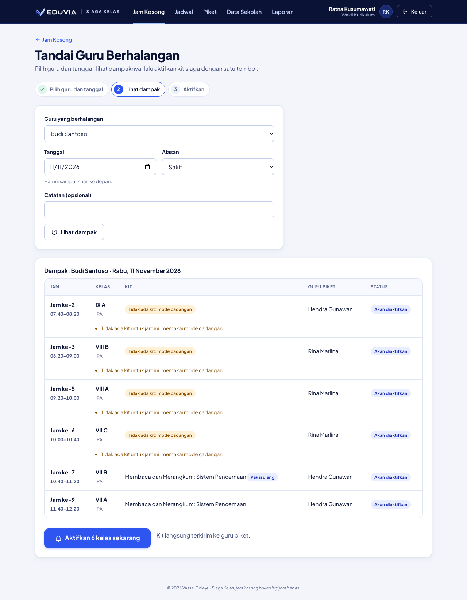 | 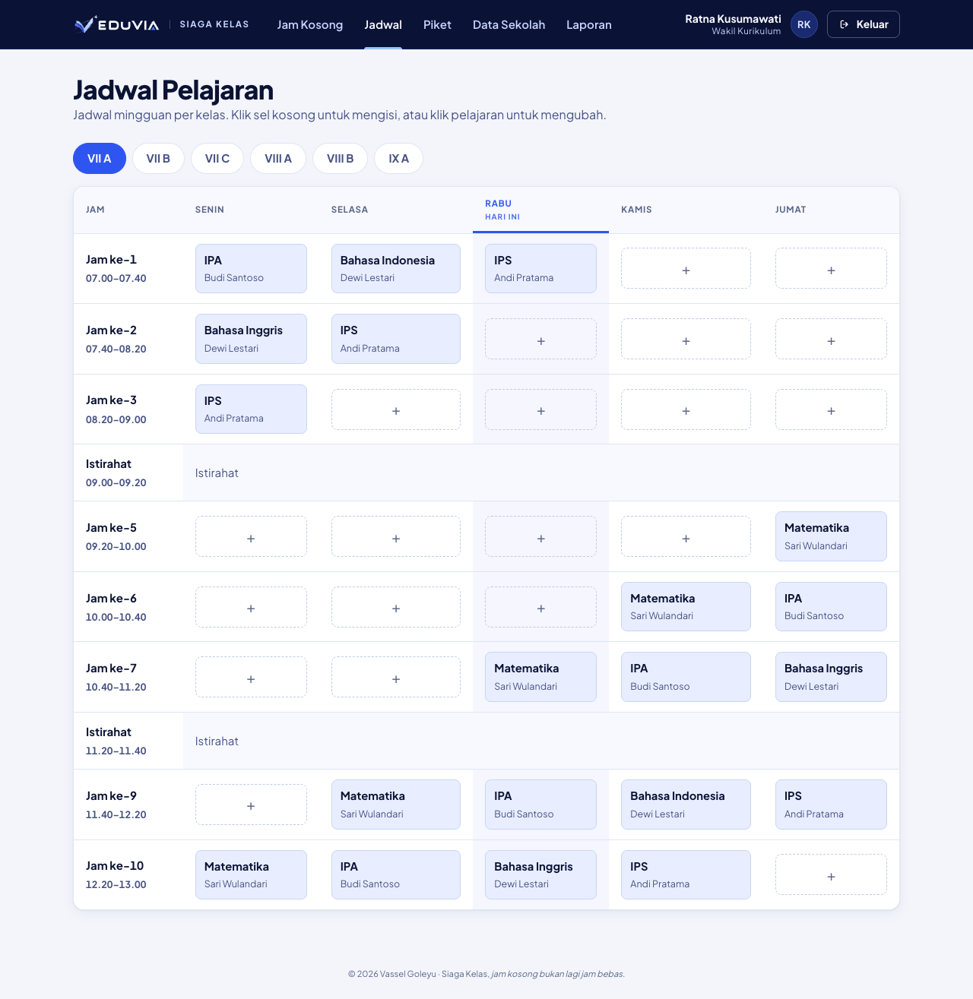 |
| **Pratinjau dampak** sebelum menekan tombol: kit, guru piket, peringatan | **Jadwal** per kelas; kolom hari ini ditandai, klik sel untuk mengisi |
| 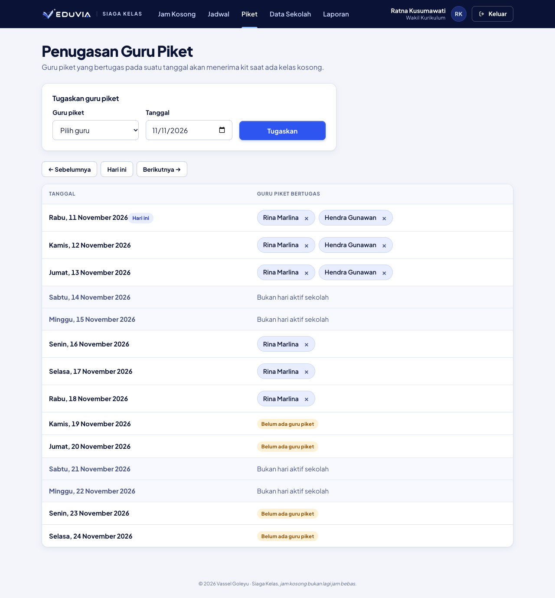 | 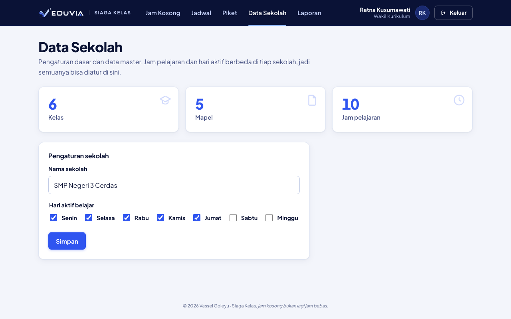 |
| **Penugasan piket** per tanggal, rentang 14 hari | **Data sekolah**: hari aktif, kelas, mapel, jam pelajaran |

### Guru piket: slip yang masuk sendiri

| | |
|---|---|
| 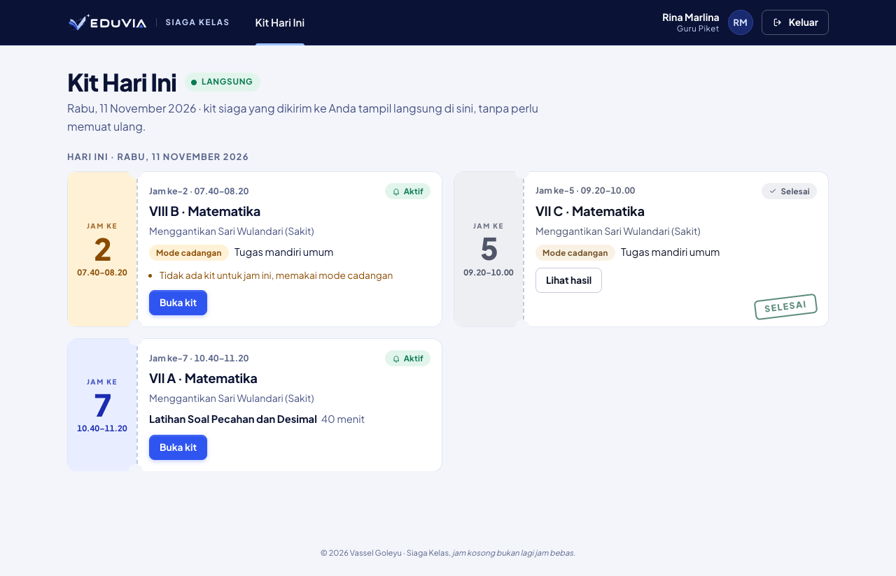 | 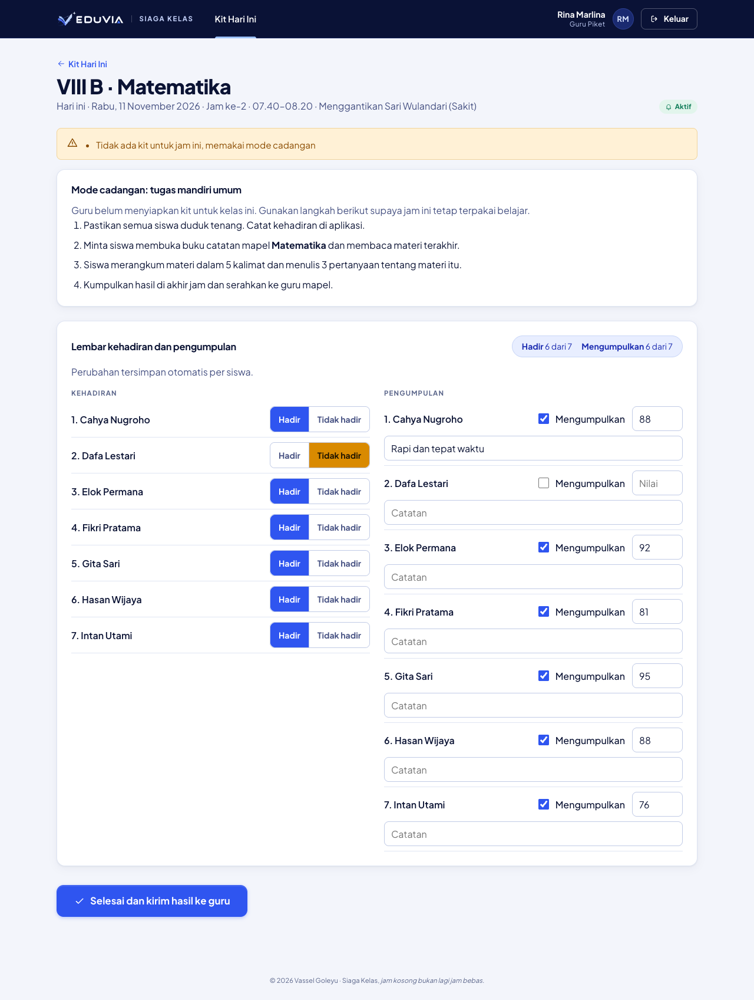 |
| **Kit Hari Ini**: slip jam muncul langsung, tanpa memuat ulang | **Lembar kehadiran dan pengumpulan**, tersimpan otomatis per baris |

### Guru mapel: kit dan hasilnya

| | |
|---|---|
| 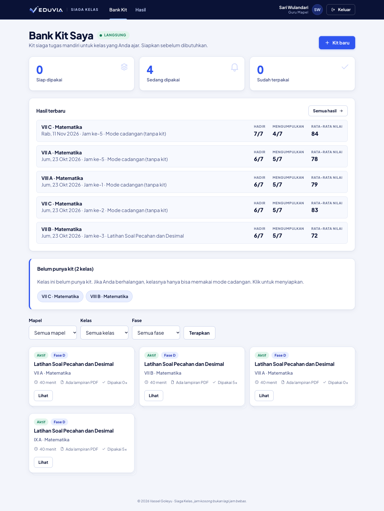 | 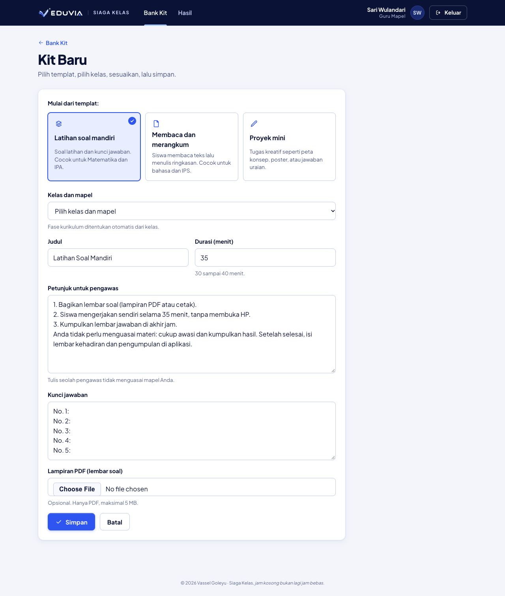 |
| **Bank kit**: filter, status, hasil terbaru live | **Kit baru** dari templat, dengan lampiran PDF opsional |
| 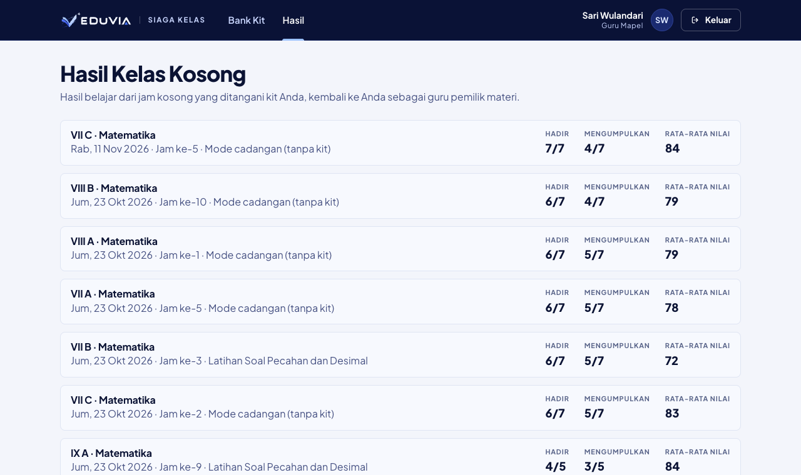 | 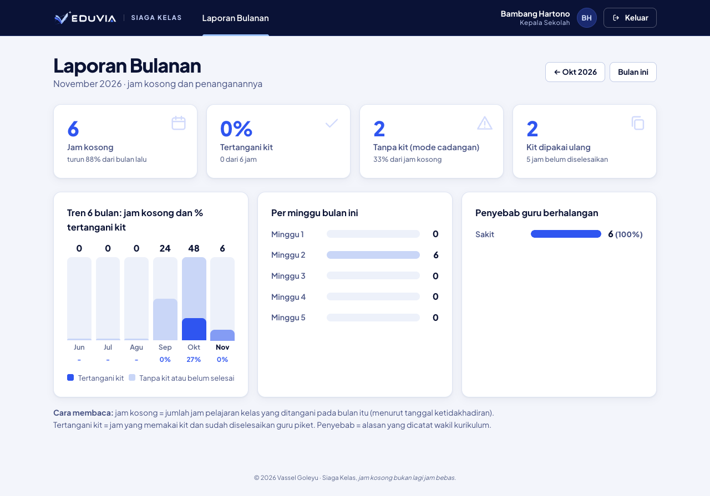 |
| **Hasil kelas kosong**: hadir, mengumpulkan, rata-rata nilai | **Laporan bulanan** untuk kepala sekolah |

### Masuk, mode gelap, dan ponsel

| | | |
|---|---|---|
| 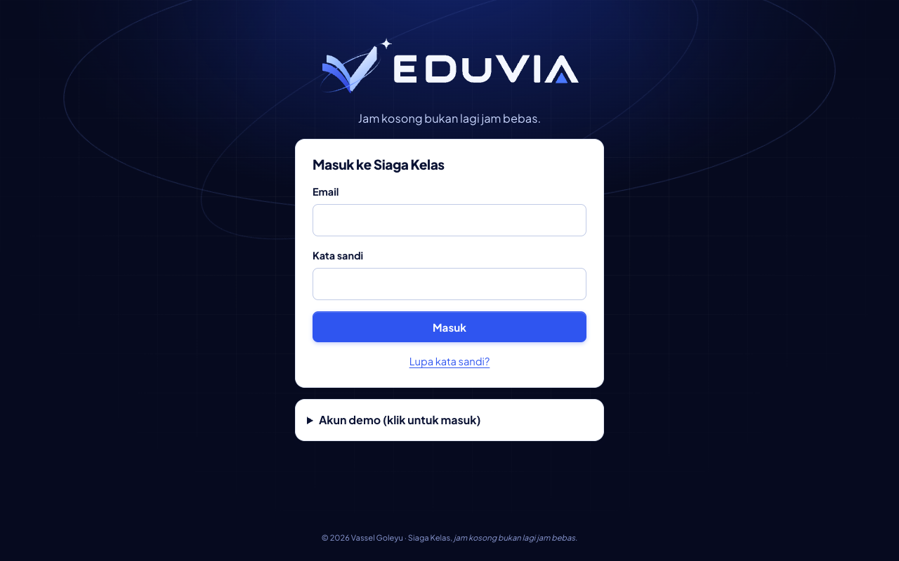 | 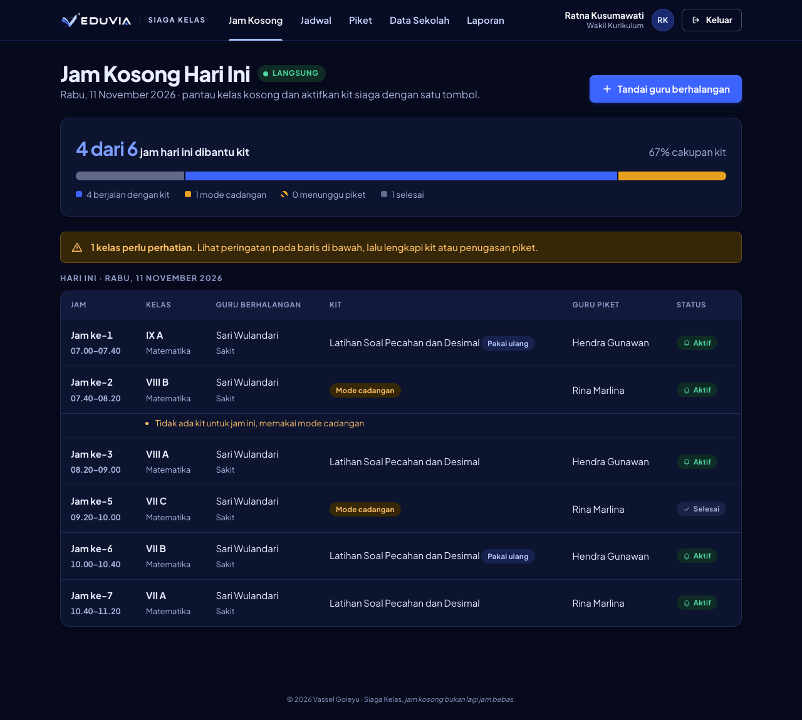 | 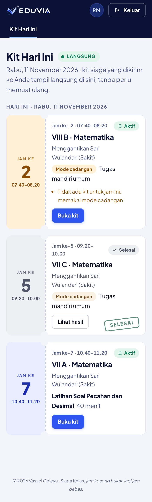 |
| **Masuk** dengan akun demo sekali klik | **Mode gelap** otomatis | **Ponsel**: slip guru piket |

<p align="right">(<a href="#readme-top">kembali ke atas</a>)</p>

## Menjalankan

Hanya butuh Docker (tanpa Ruby atau PostgreSQL di komputer):

```bash
git clone <url-repo-ini> siaga-kelas && cd siaga-kelas
docker compose up
```

Tunggu sampai muncul `Listening on http://0.0.0.0:3000` (±1 menit pertama untuk membangun database, migrasi, dan seed), lalu buka <http://localhost:3000>. Database, migrasi, dan data demo disiapkan otomatis (seed aman dijalankan berulang).

| Kebutuhan | Cara |
|---|---|
| Port 3000 terpakai | `APP_PORT=3100 docker compose up` |
| Dibuka lewat nama komputer (bukan `localhost`/IP) | `ALLOWED_HOSTS=nama-komputer docker compose up` |
| Mulai dari data bersih | `docker compose down -v && docker compose up` |
| Variabel lain | salin `.env.example` menjadi `.env` |

Skrip demo 3 menit untuk juri: **[docs/DEMO.md](docs/DEMO.md)**.

### Akun demo

Semua akun memakai kata sandi `siaga2026`. Di halaman masuk ada tombol **Akun demo** sekali klik.

| Peran | Email | Bisa |
|---|---|---|
| Guru mapel | `sari@siaga.test`, `budi@siaga.test`, `dewi@siaga.test`, `andi@siaga.test` | Menyiapkan kit, melihat hasil kelas kosong miliknya |
| Guru piket | `rina@siaga.test`, `hendra@siaga.test` | Menerima kit, mengisi kehadiran dan pengumpulan |
| Wakil kurikulum | `ratna@siaga.test` | Jadwal, data sekolah, penugasan piket, aktivasi satu tombol, laporan |
| Kepala sekolah | `bambang@siaga.test` | Hanya laporan bulanan |

(Siswa tidak perlu login: kehadiran dan pengumpulan diisi guru piket.)

<p align="right">(<a href="#readme-top">kembali ke atas</a>)</p>

## Alur utama

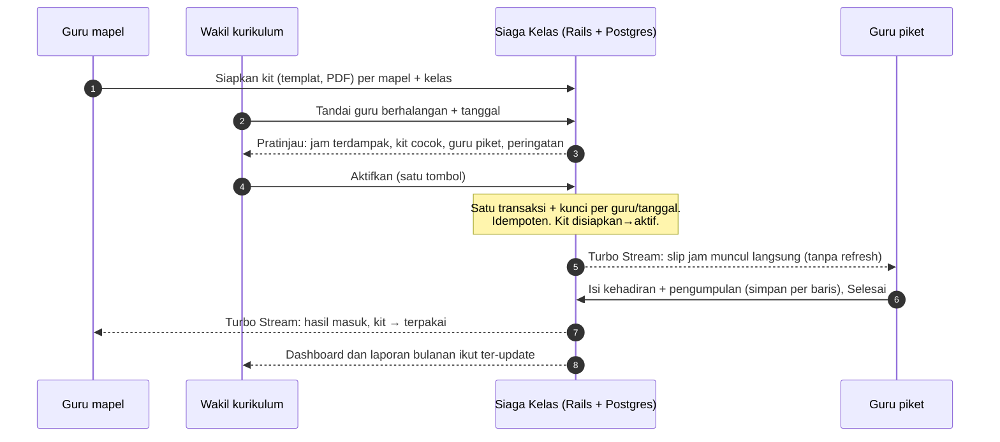

**Kasus tepi yang ditangani dan dites:** tidak ada kit (mode cadangan + peringatan), kit sudah terpakai (dipakai ulang dengan penanda), dua kelas kosong bersamaan (dibagi ke guru piket berbeda, atau peringatan bila hanya satu), guru piket belum ditugaskan (aktivasi menunggu, otomatis diberikan saat piket ditugaskan), jam ganda mapel yang sama, klik ganda (idempoten), jam yang sudah diselesaikan di tab lain (halaman otomatis terkunci), dan jam pelajaran serta hari aktif yang dikonfigurasi per sekolah (bukan hard-code).

<p align="right">(<a href="#readme-top">kembali ke atas</a>)</p>

## Arsitektur

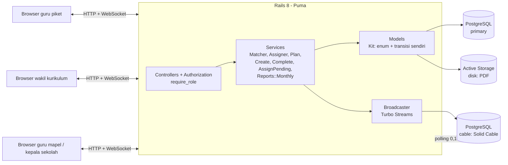

- **Autentikasi:** generator bawaan Rails 8. **Otorisasi:** concern `Authorization` (`require_role`) + query selalu di-scope dari pengguna/sekolah, jadi ID milik orang lain menghasilkan 404.
- **Status kit:** `disiapkan → aktif → terpakai → aktif (pakai ulang)`, hanya lewat `activate!`, `complete!`, `reuse!`. Transisi tidak valid melempar `Kit::InvalidTransition` (dites untuk semua 9 kombinasi).
- **Integritas data:** foreign key, indeks unik, dan check constraint di database (mis. satu kit tidak bisa aktif di dua tempat; satu jam dari satu ketidakhadiran hanya diaktifkan sekali).
- **Realtime:** Turbo Streams lewat **Solid Cable** (pesan di PostgreSQL, tanpa Redis). Siaran dikirim setelah commit; kegagalan siaran tidak membatalkan aktivasi.
- **CSS:** 7 berkas berlapis (`@layer`) di `app/assets/stylesheets/`, token terang/gelap, satu berkas gerak.

### Dibangun dengan

| Lapisan | Pilihan |
|---|---|
| Bahasa dan kerangka | Ruby 3.4, Ruby on Rails 8.1 (Puma) |
| Basis data | PostgreSQL 17 (data utama dan kanal realtime) |
| Front end | Hotwire (Turbo Drive, Frames, Streams) + Stimulus, HTML5 dan CSS3 murni (tanpa Tailwind/Bootstrap, tanpa React/Vue) |
| Realtime dan berkas | Solid Cable, Active Storage (disk) |
| Infrastruktur | Docker Compose |
| Kualitas | Minitest, Rubocop (omakase), Brakeman, bundler-audit, Postman/newman |

Tanpa Redis, tanpa Devise, tanpa gem state machine.

### Rute utama

| Peran | Halaman |
|---|---|
| Guru mapel | `/kits` (bank kit, filter, templat, PDF), `/results` (hasil kelas kosong) |
| Wakil kurikulum | `/curriculum` (dashboard live), `/curriculum/absences/new` (pratinjau + aktifkan), `/curriculum/lessons` (jadwal), `/curriculum/duty_assignments`, `/curriculum/school`, `/periods`, `/school_classes`, `/subjects`, `/reports/:bulan` |
| Guru piket | `/duty` (slip live), `/duty/activations/:id` (kit + lembar + Selesai) |
| Kepala sekolah | `/reports/:bulan` |

<p align="right">(<a href="#readme-top">kembali ke atas</a>)</p>

## Tes dan kualitas

```bash
docker compose run --rm app bash -c "RAILS_ENV=test bin/rails db:prepare && bin/rails test"
docker compose run --rm app bin/rubocop
docker compose run --rm app bin/brakeman -q --no-pager
```

- **384 tes, ±2.200 assertion, 0 gagal** (Minitest), ditulis bersama fiturnya: model (termasuk transisi kit), layanan (idempotensi, rollback, konkurensi 4 thread), integrasi dua sesi, siaran Turbo, otorisasi per peran × halaman, **penyapu seluruh rute** (tanpa login semua mengarah ke masuk; untuk tiap peran tidak ada rute yang 5xx), CSP/CSRF/cookie/rate limit, penjaga N+1 (jumlah query tetap saat data bertambah), dan satu alur penuh lintas lima peran.
- **Audit klik di Chrome sungguhan:** semua tombol, tautan, dialog konfirmasi, dan formulir tiap peran diuji dengan klik nyata, termasuk tampilan 375 px. Temuannya (tombol hapus jadwal yang tidak menghapus, kolom nilai yang kehilangan fokus saat autosave, tab lama yang gagal diam-diam) sudah diperbaiki dan dikunci dengan tes.
- **Postman:** `postman/` berisi koleksi 82 request (6 alur per peran) dan environment. Diverifikasi dengan newman: **82 request, 233 asersi, 0 gagal**, tiga putaran berturut-turut.
  ```bash
  docker run --rm -v "$PWD/postman":/etc/newman postman/newman:alpine run siaga-kelas.postman_collection.json \
    -e siaga-kelas.local.postman_environment.json --env-var base_url=http://host.docker.internal:3000 --working-dir /etc/newman
  ```
  (Dari dalam Docker, jalankan aplikasi dengan `ALLOWED_HOSTS=host.docker.internal`. Di Postman desktop cukup `base_url` = `http://localhost:3000`.) Koleksi mengubah data seed (menyelesaikan satu aktivasi per putaran); untuk mengulang dari nol: `docker compose down -v`.
- **Skrip browser:** `script/browser/` berisi skrip Chrome DevTools (realtime, hasil live, simpan otomatis, tangkapan layar + deteksi error JS/CSP). Pada laptop yang sedang tidak sibuk, kartu tiba di Chrome guru piket **±0,3 detik** setelah klik wakil kurikulum tanpa reload, dan hasil tiba di guru mapel **0,1–0,3 detik** setelah Selesai. **Angka ini bergantung beban mesin**: saat mesin uji sangat sibuk, hasil yang sama tiba **±1,5 detik** dan koleksi Postman butuh ±1 menit. Perilakunya tetap benar; hanya lebih lambat. Peristiwa pertama setelah server baru menyala juga lebih lambat (kompilasi template mode development).
- Rubocop (omakase), Brakeman, dan `bundler-audit`: bersih.

<p align="right">(<a href="#readme-top">kembali ke atas</a>)</p>

## Keamanan

- Otorisasi di **setiap aksi** (peran + kepemilikan), parameter lewat strong parameters (`params.expect`), pemilik/status/penghitung kit tidak pernah diterima dari form.
- **CSRF** aktif (token per formulir). **Content-Security-Policy** ketat dengan nonce, tanpa framing, `object-src 'none'`.
- **Lampiran PDF:** tipe, ukuran (≤ 5 MB), dan **magic byte `%PDF-`** dicek (teks yang dinamai `.pdf` ditolak); unduhan lewat aksi dengan pengecekan hak, bukan URL publik (rute Active Storage dimatikan).
- **Batas percobaan masuk** dua lapis (per akun+IP dan per IP) supaya satu sekolah di belakang satu IP tidak saling memblokir. Kata sandi ≥ 8 karakter; cookie sesi `httponly` + `SameSite=Lax`.
- Siaran realtime memakai nama stream **bertanda tangan** yang ditentukan server; koneksi Cable tanpa login ditolak.
- Detail dan alasan keputusan: [docs/DECISIONS.md](docs/DECISIONS.md).

## Ringan untuk perangkat sekolah

Diukur di mode development (tanpa minifikasi), ukuran sebelum/sesudah gzip:

| Aset | Ukuran |
|---|---|
| HTML tiap halaman | 15–31 KB (**3–4 KB** gzip) |
| CSS (7 berkas) | 48 KB (13 KB gzip) |
| Font Plus Jakarta Sans (lokal) | 27 KB |
| JavaScript (Turbo, Stimulus, 6 controller kecil) | 159 KB |

Tanpa framework CSS/JS berat, tanpa SPA. Animasi hanya `transform` dan `opacity`, dan mati total bila pengguna memilih "kurangi gerakan".

## Desain dan aksesibilitas

- Identitas dari logo EDUVIA: kartu guru piket berbentuk **slip jadwal**, kartu kit bertumpuk seperti halaman di logo, jadwal menandai **hari ini**.
- Mode terang dan gelap otomatis; kontras semua pasangan warna diaudit (≥ 4,5:1).
- Responsif (menu menggulir di ponsel, tabel menjadi kartu), pintasan "Lewati ke konten utama", fokus papan ketik terlihat, `aria-live` untuk pembaruan realtime.

<p align="right">(<a href="#readme-top">kembali ke atas</a>)</p>

## Struktur singkat

```
app/controllers/        concerns (authentication, authorization), curriculum/, duty/, kits, results, reports
app/models/             school, user, period, school_class, subject, student, lesson, duty_assignment,
                        kit (transisi status), kit_template, absence, activation, attendance_record, submission
app/services/           activations/ (plan, create, complete, assign_pending, broadcaster), kits/matcher,
                        duty/assigner, reports/monthly
app/views/              ERB + Turbo Frames/Streams; app/javascript/controllers: 6 controller Stimulus kecil
app/assets/stylesheets/ 7 berkas berlapis; app/assets/fonts/: Plus Jakarta Sans (OFL)
db/                     migrasi, schema.rb, cable_schema.rb, seeds.rb (+ seed_files/)
docs/                   PLAN.md, DECISIONS.md (59 keputusan), FUTURE.md, DEMO.md, screenshots/
postman/                koleksi + environment + berkas uji
script/browser/         skrip verifikasi di Chrome (CDP)
logo/                   logo EDUVIA: SVG beranimasi, PNG transparan, favicon, build.mjs
test/                   models, services, integration, channels, helpers, fixtures
```

<p align="right">(<a href="#readme-top">kembali ke atas</a>)</p>

## Known limitations

Daftar jujur hal yang **belum** atau **tidak** dijamin MVP ini:

1. **Mode demo, bukan siap produksi.** `docker compose up` menjalankan `RAILS_ENV=development` (sesuai keputusan D8) agar juri tidak perlu mengatur SSL/rahasia. Penerapan produksi perlu: HTTPS, kredensial/secret, aset yang diprekompilasi, cache bersama, dan pemantauan. Konfigurasi `production.rb` bawaan Rails belum diuji.
2. **Atur ulang kata sandi lewat email belum berfungsi** (SMTP belum dikonfigurasi). Halamannya ada, emailnya tidak terkirim.
3. **Tidak ada UI untuk mengelola pengguna dan siswa**; keduanya hanya lewat seed. Satu sekolah per instalasi (model `School` ada, UI multi-sekolah tidak).
4. **Aktivasi yang sudah diselesaikan tidak bisa dibuka kembali** (lembar terkunci). Salah tekan "Selesai" harus ditangani di luar aplikasi.
5. **Ketidakhadiran per hari penuh** (bukan sebagian jam), dibatasi hari ini sampai 7 hari ke depan, dan aktivasi tidak terjadwal otomatis pada hari-H.
6. **Pembagian guru piket sederhana**: beban terkecil dan menghindari bentrok jam; bukan optimasi penuh.
7. **Laporan hanya agregat bulanan** (tanpa per guru/kelas/ekspor). Data riwayat dua bulan sebelumnya adalah **data seed sintetis**, bukan data sekolah nyata.
8. **Paginasi:** daftar hasil dibatasi 50; bank kit, jadwal, dan lain-lain tanpa paginasi (jumlah data per guru kecil).
9. **Lampiran** hanya PDF ≤ 5 MB, disimpan di disk lokal (volume Docker), tanpa pemindaian virus.
10. **Realtime lewat polling PostgreSQL (Solid Cable)**: cocok untuk satu sekolah, **tidak diuji beban**. Konkurensi diuji sampai 4 koneksi paralel.
11. **Batas percobaan masuk memakai memori per proses**: hilang saat restart dan tidak dibagi antar server.
12. **Hanya browser modern** (Rails `allow_browser :modern`; memakai `:has`, `@layer`, View Transitions yang turun dengan halus bila tidak didukung). Pengujian klik dilakukan di Chrome saja.
13. **Tidak ada tes sistem berbasis browser di `rails test`** (Capybara). Pembuktian browser memakai tes integrasi dua sesi + skrip Chrome di `script/browser/` yang dijalankan manual.
14. **Belum diuji di perangkat atau jaringan sekolah sungguhan**, dan **belum diuji dengan pembaca layar**. Kontras dan semantik sudah diaudit, tetapi pengujian pengguna nyata belum ada. Angka ukuran halaman diukur di mode development.
15. **Zona waktu tetap Asia/Jakarta**, satu pengaturan jam pelajaran per sekolah. Tidak ada log audit perubahan data.
16. Tombol pilih berkas ("Choose File") mengikuti bahasa browser. Di ponsel, menu atas wakil kurikulum menggulir ke samping tanpa petunjuk visual, dan navigasi laporan bulanan tidak punya batas bulan paling awal.
17. **Klaim kebaruan produk belum diverifikasi** (lihat catatan di atas).

<p align="right">(<a href="#readme-top">kembali ke atas</a>)</p>

## Peta jalan

Ide di luar MVP dicatat di **[docs/FUTURE.md](docs/FUTURE.md)**, di antaranya:

- [ ] Bank kit lintas sekolah (berbagi dengan kurasi dan lisensi)
- [ ] Analitik penyebab jam kosong dan laporan per guru, per kelas, ekspor CSV
- [ ] Manajemen pengguna dan siswa lewat UI, dukungan banyak sekolah
- [ ] Notifikasi di luar aplikasi dan atur ulang kata sandi lewat email sungguhan
- [ ] Aktivasi terjadwal otomatis, absensi sebagian hari, buka kembali aktivasi
- [ ] Tes sistem dengan browser (Capybara) dan penerapan produksi (HTTPS, secret, pemantauan)

## Penulis dan lisensi

Dibuat oleh **Vassel Goleyu**. Copyright (c) 2026 Vassel Goleyu. All rights reserved. Lihat [LICENSE](LICENSE).

Font Plus Jakarta Sans © The Plus Jakarta Sans Project Authors, lisensi SIL OFL 1.1 (`app/assets/fonts/PlusJakartaSans-OFL.txt`).

<p align="right">(<a href="#readme-top">kembali ke atas</a>)</p>
