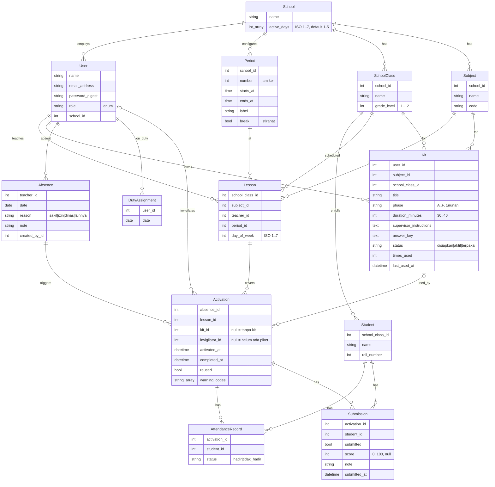

# Siaga Kelas — Rencana (Fase 0)

> *"Jam kosong bukan lagi jam bebas."*
> **Catatan:** ini dokumen perencanaan awal (Fase 0). Implementasi akhir menyimpang di beberapa titik (mis. pratinjau memakai GET + Turbo Frame, tanpa halaman `activations` terpisah, ditambah toast, CSP, dan batas percobaan masuk). Semua penyimpangan beserta alasannya dicatat di [DECISIONS.md](DECISIONS.md); keadaan terbaru ada di [README.md](../README.md).
> Milik Vassel Goleyu, © 2026. Seluruh hak dilindungi.

Konvensi: kode, tabel, dan route memakai bahasa Inggris. Antarmuka, pesan, dan dokumen memakai bahasa Indonesia. Nilai enum yang menyangkut domain sekolah (`disiapkan`, `aktif`, `terpakai`, `guru_piket`, ...) memakai bahasa Indonesia sesuai brief.

---

## 1. Ringkasan keputusan arsitektur

| Hal | Keputusan | Alasan singkat |
|---|---|---|
| Runtime | Rails 8 + Ruby 3.4 **hanya di dalam Docker** | Mac ini hanya punya Ruby 2.6 dan tanpa Rails/psql. Juri juga cukup `docker compose up`. |
| Generator | `rails new . --database=postgresql --skip-solid --skip-jbuilder --skip-kamal --skip-thruster` | Tidak perlu Solid Queue/Cache. Solid Cable ditambah manual. |
| Background job | Active Job adapter `:async` (dalam proses) | Broadcast Turbo cukup sinkron/async. Tanpa worker terpisah. |
| Realtime | Turbo Streams, `turbo_stream_from` (nama stream bertanda tangan), Solid Cable di Postgres | Tanpa Redis. |
| Auth | Generator `bin/rails generate authentication` bawaan Rails 8 | Sesuai wajib. Kolom `email_address`. Ada `rate_limit` bawaan di login. |
| Otorisasi | Concern `Authorization` (`require_role`, `can?`) + scoping lewat `Current.user` | Tanpa gem. |
| State kit | `enum :status` + method `activate!`, `complete!`, `reuse!`, `Kit::InvalidTransition` | Tanpa gem state machine. |
| Frontend | Propshaft + CSS murni (token CSS custom property), importmap, Stimulus ≤ 3 controller kecil | Ringan untuk perangkat sekolah. |
| Tes | Minitest + fixtures. Tes model, service, integrasi (termasuk `assert_turbo_stream_broadcasts`), 1 tes sistem dua-browser (profil Docker `test`) | Tes realtime tidak bergantung browser. |
| Mode demo | `docker compose up` menjalankan `RAILS_ENV=development` dengan `db:prepare` + seed idempoten otomatis | Paling sedikit titik gagal bagi juri. Dicatat di Known limitations. |
| Zona waktu | `Asia/Jakarta` | Hari/jam jadwal harus sesuai waktu sekolah. |

---

## 2. Model data (ERD)

Perubahan dari usulan brief, semuanya diberi alasan:

1. **Tambah `School` dan `Period`.** Brief meminta jam pelajaran dan hari "bisa dikonfigurasi, bukan hard-code". `Period` (jam ke-N, mulai, selesai) dan `School#active_days` memenuhi itu. `Lesson` menunjuk `Period`, jadi "rentang waktu" tidak diduplikasi.
2. **Tambah `DutyAssignment`.** Brief menyebut "penugasan guru piket" tetapi tidak ada tabelnya. Satu baris = satu guru piket bertugas pada satu tanggal.
3. **`Kit.phase` diturunkan dari kelas** (Kelas 1–2 = Fase A, 3–4 = B, 5–6 = C, 7–9 = D, 10 = E, 11–12 = F). Jadi kit selalu terikat ke fase kurikulum yang benar dan tidak bisa salah input.
4. **`Activation.kit_id` boleh kosong.** Jam kosong tanpa kit tetap tercatat (untuk laporan) dan menampilkan mode cadangan, bukan error.
5. **`Activation.warning_codes` (array string)** memuat `no_kit`, `no_invigilator`, `concurrent_conflict` agar kartu piket dan laporan bisa menampilkan peringatan tanpa query tambahan.
6. **Templat kit = PORO `KitTemplate`**, bukan tabel (tiga templat tetap, tidak perlu CRUD).



Active Storage: `Kit has_one_attached :worksheet` (PDF).

### Indeks, foreign key, dan constraint

| Tabel | Constraint / indeks | Tujuan |
|---|---|---|
| semua FK | `foreign_key: true` + indeks | Integritas, join cepat |
| `users` | unik `email_address` (lower-case); indeks `[school_id, role]` | Login; daftar guru piket |
| `periods` | unik `[school_id, number]` | Satu jam ke-N per sekolah |
| `school_classes` | unik `[school_id, name]` | |
| `subjects` | unik `[school_id, code]` | |
| `students` | unik `[school_class_id, roll_number]` | |
| `lessons` | unik `[school_class_id, day_of_week, period_id]` | Kelas tak bisa dobel jam |
| `lessons` | unik `[teacher_id, day_of_week, period_id]` | Guru tak bisa mengajar dua kelas bersamaan |
| `lessons` | indeks `[teacher_id, day_of_week]` | Hitung jam terdampak |
| `kits` | indeks `[subject_id, school_class_id, status]`; indeks `[user_id, status]` | Matcher kit; dashboard guru |
| `absences` | unik `[teacher_id, date]`; indeks `[date]` | Idempotensi; laporan |
| `duty_assignments` | unik `[user_id, date]`; indeks `[date]` | |
| `activations` | unik `[absence_id, lesson_id]` | **Idempotensi aktivasi** |
| `activations` | unik parsial `kit_id WHERE completed_at IS NULL` | Satu kit tidak bisa aktif di dua tempat sekaligus |
| `activations` | indeks `[invigilator_id, completed_at]`; `[activated_at]` | Dashboard piket; laporan bulanan |
| `attendance_records`, `submissions` | unik `[activation_id, student_id]` | Satu baris per siswa |

### Validasi utama

- `User`: `role` wajib ∈ enum, nama wajib, email unik; `has_secure_password`.
- `Kit`: judul wajib; `duration_minutes` 30–40; `supervisor_instructions` wajib; `user` harus `guru_mapel`; `subject` dan `school_class` satu sekolah dengan pemilik; **pemilik harus mengajar mapel itu di kelas itu** (ada `Lesson` yang cocok); `phase` otomatis dari `grade_level`; PDF: tipe `application/pdf` (cek content type *dan* magic byte `%PDF`), ≤ 5 MB.
- `Lesson`: `day_of_week` ∈ `school.active_days`; guru harus `guru_mapel`; `period` bukan istirahat.
- `Absence`: tanggal hari aktif sekolah, ≥ hari ini; pembuat harus `wakil_kurikulum`.
- `DutyAssignment`: user harus `guru_piket`.
- `Submission`: `score` 0–100 atau kosong.

### Transisi status Kit

```
disiapkan --activate!--> aktif --complete!--> terpakai
                           ^                       |
                           +-------reuse!----------+   (menandai Activation#reused = true)
```

Semua transisi lain melempar `Kit::InvalidTransition`. Tiap transisi memakai `with_lock` agar aman dari balapan. Tes unit mencakup 3 transisi valid dan semua kombinasi tidak valid.

---

## 3. Route

```ruby
# Auth bawaan Rails 8
resource  :session                              # new, create, destroy
resources :passwords, param: :token             # reset password (bawaan generator)

root "dashboards#show"                          # redirect sesuai role

# --- guru_mapel ---
resources :kits do                              # bank kit milik sendiri
  member { post :duplicate }                    # salin kit jadi 'disiapkan'
end
resources :results, only: %i[index show]        # hasil siswa dari kit milik sendiri (activations)

# --- wakil_kurikulum ---
namespace :curriculum do
  root "dashboards#show"                        # jam kosong hari ini + status
  resource  :school, only: %i[show update]      # nama, hari aktif
  resources :periods, except: :show             # jam pelajaran (jam ke-, rentang waktu)
  resources :school_classes, except: :show
  resources :subjects, except: :show
  resources :lessons, except: :show             # jadwal pelajaran
  resources :duty_assignments, only: %i[index create destroy]
  resources :absences, only: %i[new create] do  # pilih guru + tanggal -> pratinjau -> Aktifkan
    collection { post :preview }                # Turbo Frame: jam terdampak + kit cocok
  end
  resources :activations, only: %i[index show]  # pantau status semua aktivasi
end

# --- guru_piket ---
namespace :duty do
  root "activations#index"                      # kartu kit aktif (live via Turbo Stream)
  resources :activations, only: %i[show] do
    member { patch :complete }                  # "Selesai" -> kit terpakai
    resources :attendance_records, only: :update    # simpan inline per baris
    resources :submissions, only: :update           # simpan inline per baris
  end
end

# --- kepala_sekolah + wakil_kurikulum ---
resources :reports, only: %i[index show]        # laporan bulanan; show = /reports/2026-11
```

Pembatasan tiap aksi dijelaskan di §4. Semua query di-scope dari `Current.user` / `Current.school`, jadi guru A tidak pernah bisa memuat kit guru B walau menebak ID (hasilnya 404).

---

## 4. Halaman per peran dan hak akses

| Peran | Halaman | Boleh | Tidak boleh |
|---|---|---|---|
| **guru_mapel** | Dashboard (kit saya, kit siap/aktif/terpakai, **hasil terbaru** masuk live); Bank kit (filter mapel/kelas/fase); Form kit + templat cepat + unggah PDF; Detail kit; Hasil siswa per aktivasi | CRUD kit *miliknya*, melihat hasil kit miliknya | Kit/hasil guru lain, jadwal, aktivasi, laporan |
| **guru_piket** | Daftar kartu kit aktif untuk saya (live); Detail aktivasi: instruksi pengawas, soal/PDF, kunci jawaban, **lembar kehadiran** + **lembar pengumpulan** (simpan per baris), tombol Selesai; mode cadangan bila tanpa kit | Mengisi kehadiran/pengumpulan dan menyelesaikan aktivasi *yang ditugaskan padanya*; melihat kunci jawaban (pengawas non-ahli membutuhkannya) | Mengubah jadwal atau kit; aktivasi milik piket lain |
| **wakil_kurikulum** | Dashboard hari ini; pengaturan sekolah, jam pelajaran, hari aktif; CRUD kelas, mapel, jadwal; penugasan guru piket per tanggal; **Tandai guru berhalangan → pratinjau → Aktifkan**; pantau aktivasi; laporan bulanan | Semua pengaturan sekolah, aktivasi | Mengisi kehadiran, mengedit kit guru |
| **kepala_sekolah** | Laporan bulanan saja (jumlah jam kosong, % tertangani kit, tren, penyebab) | Hanya baca laporan | Semua halaman lain (403/redirect) |
| **siswa** | — | Tidak login di MVP | — |

Mekanisme: `ApplicationController` memanggil `require_authentication` (bawaan generator). Tiap controller peran memanggil `require_role :wakil_kurikulum` dst. Ada tes integrasi per peran × per namespace yang memastikan peran lain mendapat penolakan.

---

## 5. Struktur folder

```
app/
  controllers/
    concerns/authentication.rb  authorization.rb
    curriculum/…  duty/…  (kits, results, reports, dashboards di root)
  models/                     school, period, user, school_class, subject, student, lesson,
                              kit, absence, duty_assignment, activation,
                              attendance_record, submission, current
  services/
    activations/create.rb             # alur utama (lihat §6)
    activations/complete.rb
    activations/assign_pending.rb     # ambil aktivasi 'menunggu piket' saat piket baru ditugaskan
    kits/matcher.rb                   # memilih kit untuk sebuah Lesson
    duty/assigner.rb                  # memilih guru piket (beban paling sedikit)
    reports/monthly.rb                # query agregat
  models/kit_template.rb              # PORO, 3 templat
  views/                      layouts, shared (flash, empty_state, brand), per-controller
  javascript/controllers/     autosave_controller.js  kit_template_controller.js  flash_controller.js
  assets/stylesheets/         tokens.css base.css layout.css components.css pages/*.css
  assets/images/              logo (dari /logo)
config/                       database.yml (primary + cable), cable.yml (solid_cable), routes.rb
db/                           migrate/ seeds.rb
docs/                         PLAN.md DECISIONS.md FUTURE.md DEMO.md
postman/                      siaga-kelas.postman_collection.json + environment
test/                         models/ services/ integration/ system/ fixtures/
Dockerfile  docker-compose.yml  bin/docker-entrypoint  .env.example  README.md  LICENSE
logo/                         (sudah ada) SVG animasi + PNG transparan + favicon
```

---

## 6. Kontrak alur utama: aktivasi satu tombol

Service: `Activations::Create.call(actor:, teacher:, date:, reason:, note: nil)` → `Result(ok?, activations, warnings, error)`.
Pratinjau (`preview`) memakai logika pencocokan yang sama (`Kits::Matcher`) tanpa menulis ke DB.

**Prasyarat dan otorisasi**
1. `actor.wakil_kurikulum?` — selain itu ditolak (403).
2. `teacher.guru_mapel?` dan satu sekolah dengan `actor`.
3. `date` ∈ hari aktif sekolah dan `today ≤ date ≤ today + 7`. Di luar itu: pesan galat ramah, tanpa data tertulis.

**Langkah**
1. **Hitung jam terdampak.** `Lesson` milik `teacher` pada `date.cwday`, urut `period.number`. Bila kosong → hasil `ok` dengan peringatan "Guru ini tidak mengajar pada hari tersebut"; tidak ada `Absence` dibuat.
2. **Mulai transaksi** dan ambil kunci per guru+tanggal (`pg_advisory_xact_lock`) supaya klik ganda/dua tab berurutan, bukan paralel.
3. **Absence** = `find_or_create_by(teacher, date)` (rescue `RecordNotUnique` → find). Alasan baru tidak menimpa yang lama.
4. **Untuk tiap Lesson terdampak, urut jam:**
   1. Jika `Activation(absence, lesson)` sudah ada → lewati dan catat "sudah diaktifkan" (idempotensi).
   2. **Kits::Matcher:** cari kit milik `teacher` dengan `subject` + `school_class` yang sama, urutan prioritas: `disiapkan` (paling lama diperbarui dulu) → `terpakai` (pakai ulang, `reused = true`, dengan penanda). Kit `aktif` dilewati. Bila tidak ada → `kit = nil`, `warning_codes << "no_kit"` (mode cadangan: daftar periksa pengawas umum + peringatan ke wakil kurikulum dan guru mapel).
   3. **Duty::Assigner:** ambil guru piket yang bertugas pada `date`. Pilih yang **belum punya aktivasi pada jam (`period`) yang sama**, lalu yang beban aktivasi belum selesai paling sedikit. Kasus tepi:
      - Dua kelas kosong bersamaan, piket ≥ 2 → dibagi ke piket berbeda.
      - Dua kelas kosong bersamaan, piket tunggal → tetap ditugaskan, `warning_codes << "concurrent_conflict"`.
      - Tidak ada piket ditugaskan → `invigilator = nil`, `warning_codes << "no_invigilator"`. Aktivasi menunggu; saat `DutyAssignment` untuk tanggal itu dibuat, `Activations::AssignPending` menugaskannya dan menyiarkan kartu.
   4. Buat `Activation` (`activated_at = Time.current`, `reused` sesuai matcher).
   5. Jika ada kit: `kit.activate!` (`disiapkan→aktif` atau `terpakai→aktif`).
   6. `insert_all` baris `AttendanceRecord` (status `hadir` default) dan `Submission` (`submitted: false`) untuk semua siswa kelas tersebut.
5. **Commit.** Setelah commit (`after_commit`, bukan di dalam transaksi) siarkan Turbo Streams:
   - `piket_<invigilator_id>`: `prepend` kartu kit ke daftar aktif piket (tanpa refresh).
   - `curriculum_<school_id>`: `replace` baris status jam kosong di dashboard wakil kurikulum.
6. **Hasil ke UI:** ringkasan "N kelas diaktifkan, M peringatan" + daftar peringatan (tanpa kit, tanpa piket, bentrok). Tidak ada kasus yang berujung error 500.
7. **Klik ulang** (idempotensi): hasil sama, tidak ada baris ganda, tidak ada siaran ganda. Tombol juga memakai `data-turbo-submits-with`.

**Penyelesaian** (`Activations::Complete`, oleh guru piket penerima): set `completed_at`, `kit.complete!` (`aktif→terpakai`, `times_used += 1`, `last_used_at`), siarkan `teacher_<kit.user_id>` (kartu hasil muncul live di dashboard guru mapel) dan `curriculum_<school_id>`. Idempoten bila sudah selesai.

**Invarian yang dites:** tidak ada duplikasi `Activation`; satu kit tidak aktif di dua aktivasi terbuka; setiap jam terdampak berakhir dengan tepat satu `Activation`; semua jalur (tanpa kit / tanpa piket / bentrok / kit pakai ulang) mengembalikan `Result`, tidak melempar.

---

## 7. Laporan bulanan (definisi supaya tidak ambigu)

- **Jam kosong** = jumlah `Activation` dalam bulan itu (satu jam pelajaran kelas yang kosong = satu aktivasi).
- **Tertangani kit** = aktivasi dengan `kit_id` terisi dan `completed_at` terisi. Persentase = tertangani / jam kosong.
- **Tren** = jumlah per minggu pada bulan itu + perbandingan dengan bulan sebelumnya.
- **Penyebab sederhana** = pengelompokan `absences.reason`.
- Implementasi: 3–4 query `GROUP BY` memakai indeks `[activated_at]`, tanpa N+1 (diuji dengan hitungan query). Grafik = bar HTML/CSS.

---

## 8. Seed demo (idempoten)

1 sekolah (hari aktif Senin–Jumat, 8 jam pelajaran + 2 istirahat), 6 kelas (VII A/B/C, VIII A/B, IX A) dengan 6–8 siswa per kelas, 5 mapel (Matematika, IPA, B. Indonesia, B. Inggris, IPS). **8 pengguna:** 4 guru mapel (satu mengampu dua mapel), 2 guru piket (supaya skenario dua kelas kosong bersamaan bisa didemokan), 1 wakil kurikulum, 1 kepala sekolah. Jadwal satu minggu penuh, 10 kit (campuran `disiapkan`/`terpakai`, dengan satu kelas+mapel sengaja **tanpa kit** untuk demo mode cadangan), penugasan piket hari ini, dan data aktivasi bulan lalu agar laporan tidak kosong. Kata sandi demo ada di README.

---

## 9. Urutan pengerjaan dan checkpoint

| Fase | Isi | Rencana commit (kecil) | Checkpoint |
|---|---|---|---|
| 0 | Dokumen ini, DECISIONS, FUTURE | `docs: …` | **Persetujuan rencana** |
| 1 | `rails new` di Docker; compose (app+db); auth; role + `Authorization`; layout + token CSS; seed; tes login per peran | rails new → docker → auth → role → layout → seed → tes | `docker compose up` + login tiap peran + tes lulus |
| 2 | Migrasi, model, validasi, scope; transisi Kit + tes; CRUD kelas/mapel/periode/jadwal/penugasan piket | satu commit per grup model, per CRUD | Tes model lulus |
| 3 | CRUD kit, templat, Active Storage PDF, filter | kit model/UI → templat → PDF → filter | Kit lengkap < 3 menit |
| 4 | `Kits::Matcher`, `Duty::Assigner`, `Activations::Create`, halaman wakur, Solid Cable + Turbo Streams, tes integrasi + sistem | matcher → assigner → create → UI → realtime → tes | Demo dua browser |
| 5 | Kehadiran/pengumpulan (Turbo Frame), `Complete`, hasil guru mapel, laporan bulanan | per fitur | Alur penuh kit → laporan |
| 6 | Poles UI/aksesibilitas, N+1, Postman, README, DEMO.md, review keamanan, Known limitations | per area | `docker compose up` dari nol, tes hijau |

Aturan: tes ditulis bersama fitur; tidak ada klaim "lulus" tanpa output nyata; ide di luar daftar masuk `docs/FUTURE.md`.

---

## 10. Risiko dan mitigasi

| # | Risiko | Dampak | Mitigasi |
|---|---|---|---|
| 1 | Tidak ada Ruby/Rails modern di host | `rails new` tidak bisa dijalankan lokal | Semua perintah lewat `docker run`/`docker compose run`. Diverifikasi di awal Fase 1. |
| 2 | Docker daemon belum aktif / image pertama lambat | Fase 1 tertunda | Cek `docker info` dulu. Pin image `ruby:3.4-slim`, `postgres:17`. |
| 3 | Solid Cable + Postgres perlu database terpisah (`cable`) | Siaran realtime gagal diam-diam | Konfigurasi `database.yml` multi-DB dan `cable.yml` di Fase 1, dibuktikan di Fase 4 lewat tes siaran *dan* demo dua browser. Cadangan: adapter `async` hanya untuk dev. |
| 4 | Keamanan stream: orang lain berlangganan stream piket | Kebocoran data | Hanya `turbo_stream_from` (nama stream bertanda tangan); stream ditentukan di server dari `Current.user`. Ada tes. |
| 5 | Klik ganda / dua tab aktivasi | Data ganda | Unique index + advisory lock + `create_or_find_by` + tes konkurensi sederhana. |
| 6 | Demo jatuh di akhir pekan | Tombol aktivasi "tidak ada hari" | Wakur bisa memilih hari aktif terdekat (≤ 7 hari). DEMO.md menjelaskan. Seed membuat penugasan piket untuk 7 hari ke depan. |
| 7 | Unggahan PDF berbahaya | Keamanan | Cek content type + magic byte + ukuran, nama berkas dinormalisasi, disajikan `Content-Disposition: attachment`. |
| 8 | N+1 pada laporan dan daftar kartu | Lambat di perangkat lemah | `includes`/`group`, tes hitungan query, indeks sesuai §2. |
| 9 | Tes sistem dua-browser berat (Chrome di Docker) | Image besar / flaky | Dipisah di profil compose `test`; tes realtime utama tetap tes integrasi tanpa browser. |
| 10 | Scope creep | Waktu lomba habis | Hanya daftar fitur di brief. Sisanya ke `docs/FUTURE.md`. |
| 11 | Klaim kebaruan produk | Reputasi | README memakai kalimat: "belum menemukan alat serupa dalam pencarian terbatas, perlu diverifikasi lebih lanjut". |

---

## 11. Pertanyaan terbuka untuk Anda (default saya sudah ada, murah diubah)

1. **Nama di antarmuka:** logo/brand **EDUVIA**, nama produk **Siaga Kelas**. Default: header menampilkan logo EDUVIA + label "Siaga Kelas". Jika EDUVIA adalah nama tim dan bukan produk, beri tahu.
2. **Tanggal aktivasi:** default boleh hari ini sampai 7 hari ke depan (bukan hanya hari ini).
3. **Demo:** `docker compose up` berjalan sebagai `development` (paling sedikit titik gagal), bukan `production`.
4. **"8 guru, 4 peran":** diartikan 8 pengguna = 4 guru mapel + 2 guru piket + 1 wakil kurikulum + 1 kepala sekolah.
